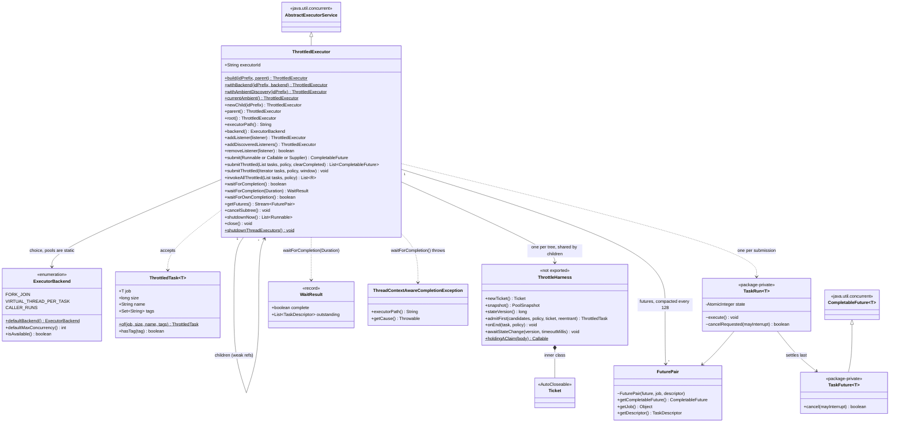
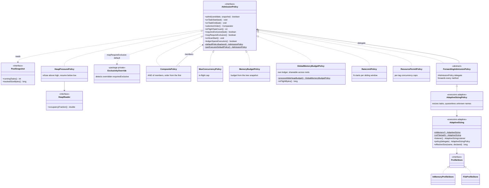
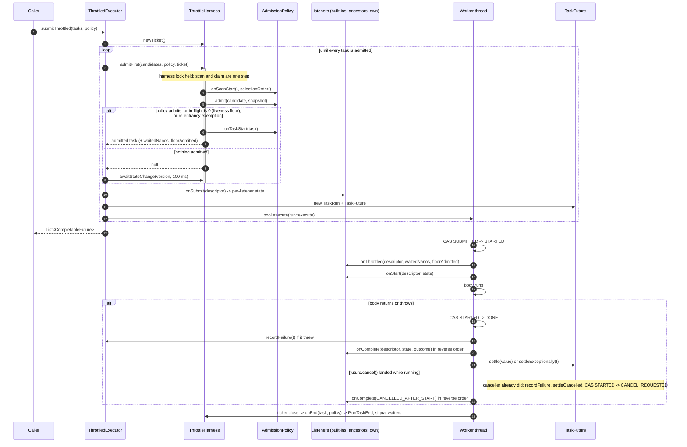
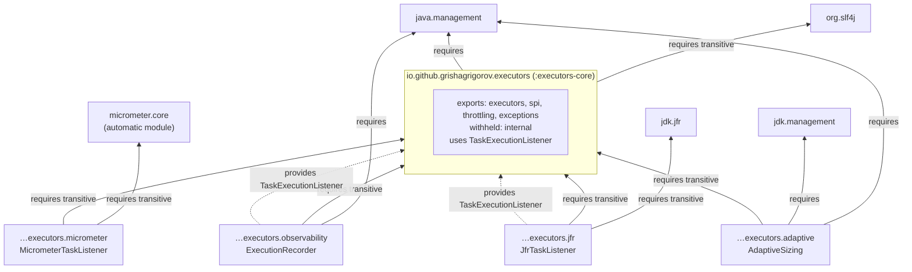
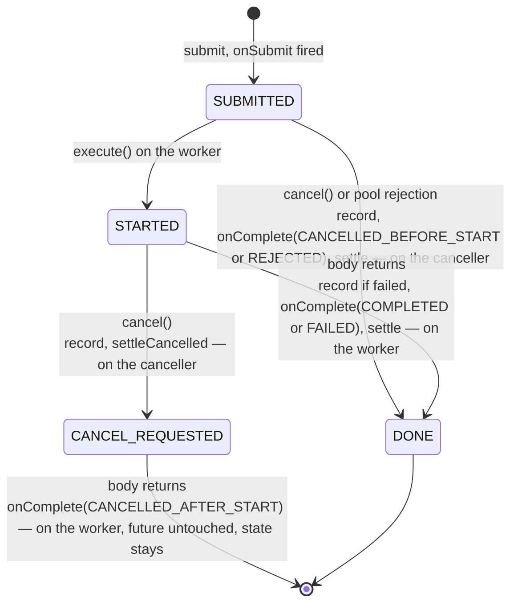

# Architecture in six diagrams

A structural map of the `executors` family. Each diagram was drawn from the sources it
links to; when the two disagree, the source wins and the diagram needs fixing. The root
[README](../README.md) is the tutorial, [CLAUDE.md](../CLAUDE.md) holds the rules, and
`ThrottleHarness`'s class Javadoc is the reference for admission mechanics.

Conventions: `<<package-private>>` and `<<not exported>>` mark types you cannot reach from
outside the module; everything else in a diagram is public API. Method lists are the ones
worth knowing, not the complete surface.

1. [The executor tree and its futures](#1-the-executor-tree-and-its-futures)
2. [Admission policies](#2-admission-policies)
3. [Listeners and the satellites](#3-listeners-and-the-satellites)
4. [Life of a throttled task](#4-life-of-a-throttled-task)
5. [Java modules](#5-java-modules)
6. [The per-task state machine](#6-the-per-task-state-machine)

## 1. The executor tree and its futures

`ThrottledExecutor` is the entry point and the only large class. A child shares its
parent's `ThrottleHarness`, so "one harness per tree" is a structural fact, not a
convention. Each submission becomes a `TaskRun` that owns the `TaskFuture` handed back to
the caller; the run, not the future, is the state machine (diagram 6).

Sources: [`ThrottledExecutor.java`](../core/src/main/java/io/github/grishagrigorov/executors/ThrottledExecutor.java),
[`ThrottledTask.java`](../core/src/main/java/io/github/grishagrigorov/executors/ThrottledTask.java),
[`FuturePair.java`](../core/src/main/java/io/github/grishagrigorov/executors/FuturePair.java),
[`WaitResult.java`](../core/src/main/java/io/github/grishagrigorov/executors/WaitResult.java),
[`internal/ThrottleHarness.java`](../core/src/main/java/io/github/grishagrigorov/executors/internal/ThrottleHarness.java).

## 2. Admission policies

`AdmissionPolicy` is a pure, advisory SPI: `admit` is the only abstract method and the
harness consults it before the liveness floor. Every built-in is `final` and implements the
interface directly. Decorators must extend `ForwardingAdmissionPolicy`, which is why
`AdaptiveSizingPolicy` from the adaptive satellite appears here rather than as a peer of
the built-ins. `defaultPolicy(backend)` is `CompositePolicy(GlobalMemoryBudgetPolicy
singleton, MaxConcurrencyPolicy)`.

Sources: [`throttling/`](../core/src/main/java/io/github/grishagrigorov/executors/throttling),
[`adaptive/AdaptiveSizingPolicy.java`](../adaptive/src/main/java/io/github/grishagrigorov/executors/adaptive/AdaptiveSizingPolicy.java),
[`adaptive/AdaptiveSizing.java`](../adaptive/src/main/java/io/github/grishagrigorov/executors/adaptive/AdaptiveSizing.java).

## 3. Listeners and the satellites

`TaskExecutionListener<C>` is the single cross-cutting seam: four hooks, all with default
bodies, and a typed per-task state `C` that `onSubmit` returns and the later hooks receive.
Two built-ins in core are a static, non-removable prefix of every executor's chain. All four
satellites plug in here, using nothing but the public SPI. Only the JFR and observability
listeners are `ServiceLoader`-discoverable; the other two need a constructor argument.

Sources: [`spi/`](../core/src/main/java/io/github/grishagrigorov/executors/spi),
[`FailFastListener.java`](../core/src/main/java/io/github/grishagrigorov/executors/FailFastListener.java),
[`jfr/`](../jfr/src/main/java/io/github/grishagrigorov/executors/jfr),
[`observability/`](../observability/src/main/java/io/github/grishagrigorov/executors/observability),
[`micrometer/`](../micrometer/src/main/java/io/github/grishagrigorov/executors/micrometer),
[`adaptive/`](../adaptive/src/main/java/io/github/grishagrigorov/executors/adaptive).

```mermaid
classDiagram
    direction TB

    class TaskExecutionListener~C~ {
        <<interface>>
        +onSubmit(task) C
        +onThrottled(task, waitedNanos, floorAdmitted) void
        +onStart(task, state) void
        +onComplete(task, state, outcome) void
    }

    class TaskDescriptor {
        <<record>>
        +ThrottledExecutor executor
        +long sequence
        +String name
        +long sizeEstimate
        +long submittedAtNanos
        +executorId() String
        +executorPath() String
    }

    class TaskOutcome {
        <<record>>
        +TaskStatus status
        +Throwable failure
        +long startedAtNanos
        +long completedAtNanos
        +bodyRan() boolean
        +durationNanos() long
    }

    class TaskStatus {
        <<enumeration>>
        COMPLETED
        FAILED
        CANCELLED_BEFORE_START
        CANCELLED_AFTER_START
        REJECTED
    }

    class AmbientExecutorListener {
        <<package-private, built-in>>
        binds the ambient executor
    }
    class MdcPropagationListener {
        <<package-private, built-in>>
        carries submitter MDC to the worker
    }
    class FailFastListener {
        opt-in: cancelSubtree on first FAILED
    }

    class JfrTaskListener {
        <<executors-jfr, discoverable>>
        one TaskEvent per task
    }
    class TaskEvent {
        <<jdk.jfr.Event>>
    }
    class ThrottleEvent {
        <<jdk.jfr.Event>>
    }

    class ExecutionRecorder {
        <<executors-observability>>
        +shared()$ ExecutionRecorder
        +snapshot() RecorderSnapshot
        +renderText() String
        +renderJson() String
        +registerMBean(name) ExecutionRecorder
    }
    class ExecutionRecorderMXBean {
        <<interface, JMX>>
    }
    class DiscoveredExecutionRecorder {
        <<discoverable>>
        delegates to ExecutionRecorder.shared()
    }
    class ExecutorNode {
        <<package-private>>
        bounded history tree, weak ref to executor
    }

    class MicrometerTaskListener {
        <<executors-micrometer>>
        counts and timers tagged by executor id
    }
    class MeterRegistry {
        <<io.micrometer>>
    }

    class AdaptiveSizingListener {
        <<executors-adaptive>>
        measures allocation, heap peak, duration
    }
    class ProfileStore {
        <<interface>>
    }

    TaskExecutionListener ..> TaskDescriptor : receives
    TaskExecutionListener ..> TaskOutcome : receives
    TaskOutcome --> TaskStatus

    TaskExecutionListener <|.. AmbientExecutorListener
    TaskExecutionListener <|.. MdcPropagationListener
    TaskExecutionListener <|.. FailFastListener
    TaskExecutionListener <|.. JfrTaskListener
    TaskExecutionListener <|.. ExecutionRecorder
    TaskExecutionListener <|.. DiscoveredExecutionRecorder
    TaskExecutionListener <|.. MicrometerTaskListener
    TaskExecutionListener <|.. AdaptiveSizingListener

    JfrTaskListener ..> TaskEvent : C = TaskEvent
    JfrTaskListener ..> ThrottleEvent
    ExecutionRecorderMXBean <|.. ExecutionRecorder
    ExecutionRecorder "1" --> "*" ExecutorNode
    DiscoveredExecutionRecorder --> ExecutionRecorder : shared()
    MicrometerTaskListener --> MeterRegistry
    AdaptiveSizingListener --> ProfileStore
```

## 4. Life of a throttled task

The ordering rules that matter most live here, not in any one class. `onSubmit` runs on
the submitter; the admission scan and the claim happen together under the harness lock;
`onThrottled` and `onStart` run on the worker just before the body; and on every completion
path the order is record the failure, fire `onComplete` in reverse listener order, then
settle the future. A cancel that lands after the body started settles the future
immediately on the canceller, and the worker later reports `CANCELLED_AFTER_START`.

Sources: `submitThrottled(List, policy, clearCompleted)` and `TaskRun` in
[`ThrottledExecutor.java`](../core/src/main/java/io/github/grishagrigorov/executors/ThrottledExecutor.java),
`admitFirst` in [`ThrottleHarness.java`](../core/src/main/java/io/github/grishagrigorov/executors/internal/ThrottleHarness.java).

## 5. Java modules

Five named modules. Core exports four packages and withholds `internal`; each satellite
exports exactly its own package. An edge marked `transitive` means the dependency's types
appear in the exporter's public signatures. The two `provides` edges are what
`addDiscoveredListeners()` finds through `ServiceLoader`.

Sources: the five [`module-info.java`](../core/src/main/java/module-info.java) files.

## 6. The per-task state machine

`TaskRun` holds one `AtomicInteger`; every transition is a single compare-and-set, so a
worker and a canceller can never both believe they own the completion. A cancel before the
body starts completes everything on the canceller's thread. A cancel after the body
started records the failure and settles the future at once, but `onComplete` waits for the
body to return, because listener thread-state lives on the worker.

Source: `TaskRun` in
[`ThrottledExecutor.java`](../core/src/main/java/io/github/grishagrigorov/executors/ThrottledExecutor.java).

